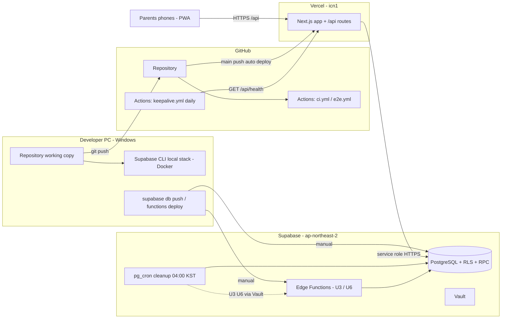

# U1 setup-data-platform — 배포 아키텍처

---

## 1. 배포 구성도

### Mermaid Diagram



### Text Alternative

```text
개발자 PC
  - 코드 -> git push -> GitHub 저장소
      - ci.yml (push/PR): typecheck, lint, deno check, 단위+PBT
      - e2e.yml (수동/main): Playwright + axe (Actions 안에서 로컬 Supabase)
      - main push -> Vercel 자동 운영 배포 (미리보기 배포 끔)
  - supabase start (Docker) -> 로컬 개발
  - supabase db push / functions deploy (수동) -> 운영 Supabase

GitHub keepalive.yml (매일) -> Vercel /api/health -> Supabase

부모님 휴대폰(PWA) -> Vercel /api/* -> Supabase (서버 전용 키)
Supabase pg_cron -> 정리 SQL 함수 (매일 04:00, 04:05 KST)
                 -> (U3·U6) Vault의 URL·키로 Edge Function 호출
```

## 2. 첫 구축 순서 (U1 Code Generation 단계에서 실행·기록)

| 순서 | 작업 | 확인 |
|---|---|---|
| 0 | **Docker Desktop 설치** (사전 조건) | `docker --version` |
| 1 | GitHub 저장소 생성, 로컬 `git init`·원격 연결, 기본 브랜치 `main` | 첫 push 성공 |
| 2 | 로컬: `supabase init` → `supabase start` → 마이그레이션 적용(`supabase db reset`) | 로컬 Studio에서 테이블 13개, anon 조회 실패 |
| 3 | 운영 Supabase 프로젝트 생성 (`ap-northeast-2`, 무료) | 대시보드 |
| 4 | `supabase link` → `supabase db push` (운영 마이그레이션) | 운영 테이블·cron 작업 2개 |
| 5 | 암호화 키 생성(운영·로컬 각각), Supabase Function 시크릿 등록 | `supabase secrets list` |
| 6 | Vercel 프로젝트 생성·GitHub 연결, 함수 지역 `icn1`, **미리보기 배포 끔**, 환경 변수 등록 | Vercel 설정 화면 |
| 7 | `main` push → 첫 운영 배포 | `/api/health` → `{ ok: true }` |
| 8 | GitHub 변수 `APP_URL` 등록, keepalive 워크플로 수동 실행 1번 | 워크플로 성공 |

## 3. 일상 배포 절차

| 변경 종류 | 절차 |
|---|---|
| 화면·API 코드 | PR(또는 직접 push) → CI 통과 → `main` push → Vercel 자동 배포 |
| DB 마이그레이션 | 로컬에서 `supabase db reset`으로 검증 → (위험하면 백업) → `supabase db push` → **그다음** 코드 배포 (새 컬럼을 쓰는 코드가 먼저 나가지 않게) |
| Edge Function (U3·U6) | 로컬 `functions serve`로 검증 → `supabase functions deploy <이름>` |
| 시크릿 | Vercel·Supabase 양쪽에 같이 반영 (암호화 키) → 재배포 |

## 4. 되돌리기 (롤백)

| 대상 | 방법 |
|---|---|
| Vercel 배포 | Vercel 대시보드에서 **이전 배포로 즉시 되돌리기** |
| DB 마이그레이션 | 되돌리는 마이그레이션을 **새로 작성해 적용** (forward fix). 데이터 삭제·구조 변경이 큰 마이그레이션은 적용 전에 `supabase db dump --data-only`와 스키마 덤프로 백업 |
| Edge Function | 이전 커밋으로 다시 `functions deploy` |
| 암호화 키 실수 | 키는 버전으로 관리하므로 이전 버전 키를 지우지 않았다면 복구 가능 (키 삭제는 재암호화 완료 확인 후에만) |

## 5. 운영 점검표 (운영 시작 후)

- [ ] 2주 동안 Supabase 일시 중지 경고 없음 (infrastructure-design.md §7)
- [ ] keepalive 워크플로가 매일 성공
- [ ] `collect_runs`에 정리 작업 기록이 매일 2건
- [ ] anon 키로 테이블 조회가 실패함 (운영에서 1회 확인)
