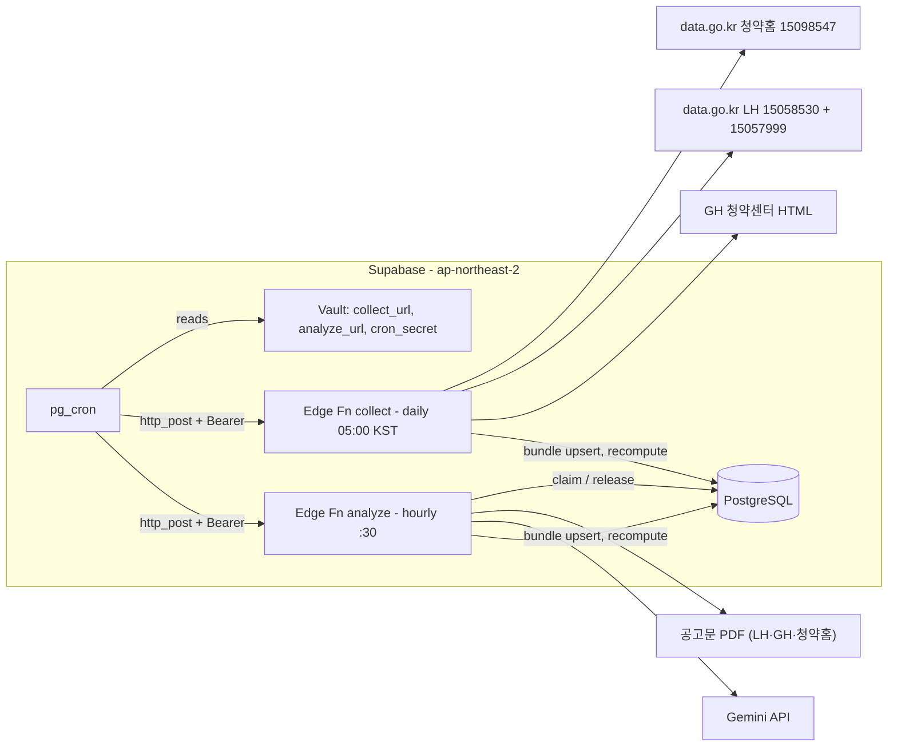

# U3 collection-pipeline — 배포 아키텍처

---

## 1. 구성도

### Mermaid Diagram



### Text Alternative

```text
pg_cron (UTC 20:00 = KST 05:00) -> Vault(collect_url, cron_secret) -> collect
   collect -> 청약홈 API, LH 목록·상세 API, GH 메인 HTML
           -> DB: 상태 조회 → 바뀐 공고만 묶음 저장(표준 요건, pending) → 판정 재계산 → 실행 기록
pg_cron (매시 30분) -> Vault(analyze_url, cron_secret) -> analyze
   analyze -> DB: 대기 공고 예약(≤2) -> 공고문 PDF 내려받기 -> Gemini 추출
           -> DB: 묶음 저장(추출 요건·요약) / 실패 시 예약 해제 → 판정 재계산 → 실행 기록
```

## 2. 첫 배포 순서 (U3 Code Generation 뒤, 사용자 작업 + AI 안내)

| 순서 | 작업 | 확인 |
|---|---|---|
| 1 | GitHub Actions(`ci`, `db-and-e2e`) 통과 | 0007 pgTAP 포함 |
| 2 | `CRON_SECRET` 생성 → `npx supabase secrets set CRON_SECRET=… DATA_GO_KR_API_KEY=… GEMINI_API_KEY=…` | `supabase secrets list` |
| 3 | Vault에 `collect_url`, `analyze_url`, `cron_secret` 생성 (SQL Editor, `vault.create_secret`) | `select name from vault.secrets` |
| 4 | `npx supabase db push` (0006 아직이면 함께, 0007) | 테이블·cron 작업 4개 |
| 5 | `npx supabase functions deploy collect analyze` | 대시보드 함수 목록 |
| 6 | 수동 1회 실행: `collect` → `analyze` (curl + Bearer) | `collect_runs` 소스별 행, `notices` 생성, 지구 후보 경고 확인 |
| 7 | 다음 날 05:00·매시 30분 자동 실행 확인 | `collect_runs` |

## 3. 롤백

| 대상 | 방법 |
|---|---|
| 함수 | 이전 커밋으로 `functions deploy` |
| cron만 멈추기 | `select cron.unschedule('collect-daily')` / `'analyze-hourly'` (긴급 정지) |
| 잘못 저장된 공고 | 원천 데이터가 다시 들어오면 해시 비교로 갱신. 전면 재처리가 필요하면 `update notices set summary_status='pending', ai_attempts=0` (재분석) |
| 0007 | forward fix 마이그레이션 (U1 규칙) |
