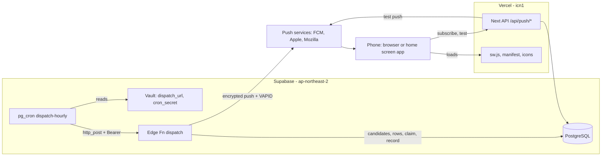

# U6 pwa-push — 배포 아키텍처

---

## 1. 구성도

### Mermaid Diagram



### Text Alternative

```text
pg_cron (매시 정각) -> Vault(dispatch_url, cron_secret) -> dispatch
   dispatch -> DB: 대상 기기·구독 -> 판정·알림 기록 묶음 -> (오래된 판정 다시 계산)
            -> 기기마다: 오늘 몫 잡기 -> 푸시 서비스로 암호화 알림 -> 결과 기록(실패면 몫 되돌림)
            -> dispatch_runs 1행
휴대폰 -> Vercel: 서비스워커·manifest·아이콘, POST /api/push/subscribe, POST /api/push/test
푸시 서비스 -> 휴대폰 서비스워커 -> 알림 표시 -> 누르면 /notice/{id} 또는 /
```

## 2. 운영 반영 순서 (Q4=A — 사용자 작업 + AI 안내, setup 문서로 제공)

| 순서 | 작업 | 확인 |
|---|---|---|
| 0 | CI(`ci`, `db-and-e2e`) 통과 | 0008 pgTAP 포함 |
| ① | `npx supabase db push` (0008) | 새 표·칸, `cron.job`에 `dispatch-hourly`·`cleanup-push`. 이후 매시 `collect_runs`에 "Vault 값 없음: dispatch_url"(정상) |
| ② | `npm run vapid:generate` → `npx supabase secrets set VAPID_PUBLIC_KEY=… VAPID_PRIVATE_KEY=… VAPID_SUBJECT=…` + Vercel 환경 변수(Production) 3개 | `supabase secrets list`(이름만 확인), Vercel 대시보드 |
| ③ | `npx supabase functions deploy dispatch` | 대시보드 함수 목록 |
| ④ | main push → Vercel 자동 배포(②의 환경 변수가 들어간 뒤여야 함) | `/manifest.webmanifest`, `/sw.js`, `/api/push/key` 200 |
| ⑤ | 어머니 휴대폰: (iPhone이면 홈 화면에 추가) → 설정 → 알림 켜기 → [시험 알림 보내기] | 알림 도착, 누르면 설정 화면 |
| ⑥ | SQL Editor: `select vault.create_secret('https://<ref>.supabase.co/functions/v1/dispatch', 'dispatch_url');` | 다음 정각부터 자동 실행 |
| ⑦ | 수동 1회: `curl.exe -X POST <dispatch_url> -H "Authorization: Bearer <cron_secret>"` (PowerShell은 `curl.exe`, 비밀값은 `Read-Host`로) | 응답 `{ hour, devices, sent, … }`, `dispatch_runs` 1행. 알림 시각이 아니면 `devices: 0`이 정상 |
| ⑧ | 다음 날 알림 시각(기본 9시)에 실제 알림 확인 | `dispatch_runs`, `notification_log` |

## 3. 되돌리기

| 상황 | 방법 |
|---|---|
| 알림이 잘못 나감(문구·대상 오류) | Vault `dispatch_url` 지우기(`delete from vault.secrets where name = 'dispatch_url'`) → 다음 정각부터 호출 안 함. 고친 뒤 다시 넣기 |
| 함수 배포 문제 | 이전 커밋으로 `functions deploy dispatch` |
| 화면(서비스워커) 문제 | Vercel 이전 배포로 되돌리기. `sw.js`는 캐시가 없어 화면 문제를 남기지 않음 |
| 0008 되돌리기 | 칸·표 추가뿐이라 그대로 둬도 앞 Unit 동작에 영향 없음. cron만 `select cron.unschedule('dispatch-hourly')` |

## 4. 로컬·CI

| 환경 | 구성 |
|---|---|
| 로컬 | `supabase start`(0008 적용), `supabase functions serve dispatch`(가짜 푸시 서비스 주소로 시험), Next는 로컬 Supabase 값으로(운영 `.env.local` 사용 금지 — U4 결정) |
| CI `db-and-e2e` | pgTAP(0008), E2E: VAPID 값은 CI에서 매번 새로 만든 임시 키(로컬 스크립트 재사용), 푸시 서비스 요청은 Playwright가 가로챔 |
