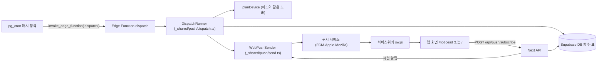

# U6 pwa-push — 논리 구성 요소

> 패턴 번호는 nfr-design-patterns.md(P-n). 순수 로직은 `_shared`(Deno·Node 공용), 실행 조립은 `_lib`(Deno)·`src/server`(Node).

---

## 1. 구성도

글로 보기: pg_cron이 매시 `dispatch`를 부르고, 실행기가 DB에서 대상·판정을 읽어 피드와 같은 규칙으로 계획한 뒤 웹 푸시를 보낸다. 푸시 서비스가 서비스워커로 전달하고, 알림을 누르면 앱 화면이 열린다. 앱은 구독을 Next API로 저장하고, 시험 알림은 Next가 같은 보내기 코드로 보낸다.

## 2. 공용 코드 `supabase/functions/_shared/push/`

| 파일 | 내용 | 패턴 |
|---|---|---|
| `base64url.ts` | base64url 인코딩·디코딩 | – |
| `vapid.ts` | 키 가져오기(`CryptoKey`), ES256 JWT(`aud` = 푸시 서비스 origin, `exp` = 12시간, `sub`), `Authorization: vapid t=…, k=…` | P-12·15 |
| `encrypt.ts` | RFC 8291 `aes128gcm`: 임시 ECDH 키, HKDF(auth secret → IKM → CEK·NONCE), 패딩 구분자 `0x02`, 레코드 크기 4096. 시험용으로 임시 키·salt 주입 가능 | NFR-U6-32 |
| `endpoint.ts` | `isAllowedPushEndpoint`, `validateSubscription`, `endpointHash` | P-14·16 |
| `send.ts` | `sendPush(target, payload, { ttl, urgency, timeoutMs })` → `SendOutcome`(sent·gone·retryable·rejected), 재시도 1번 | P-4 |
| `payload.ts` | `buildPayload(item, today)`, `testPayload()` (BR-U6-30~36) | – |
| `plan.ts` | `planDevice(rows, notifiedIds, today)` — U5 `buildFeed`의 노출·정렬 부분을 `_shared/feed/visible.ts`로 옮겨 함께 씀 | US-10 |
| `dispatch.ts` | `runDispatch(deps, now)`: 대상 읽기 → 묶음 읽기 → 다시 계산 → 작업 풀(5) → 기기별 claim·send·record/release → 집계 | P-1·3·5·9·10·11 |
| `settle.ts` | `settleDevice(outcomes)` | P-6 |
| `ports.ts` | `DispatchStore`(DB 함수 묶음), `PushTransport`(fetch 주입), `Clock` | 테스트에서 메모리·가짜로 교체 |

## 3. DB (마이그레이션 `0008_push.sql`)

| 종류 | 이름 | 내용 |
|---|---|---|
| 칸 추가 | `devices.last_push_on date`, `devices.push_baseline_at timestamptz` | P-1·8 |
| 칸 추가 | `notification_log.kind text not null default 'sent' check (kind in ('sent','baseline'))` | P-2 |
| 칸 추가 | `push_subscriptions.failing_since timestamptz` | P-6 (조정) |
| 새 표 | `push_test_log(device_id uuid references devices on delete cascade, sent_at timestamptz)` + 인덱스 | BR-U6-66 |
| 새 표 | `dispatch_runs(id, started_at, finished_at, hour, devices, sent, skipped_empty, skipped_claimed, failed, removed_subscriptions, recomputed, time_budget_exceeded, error)` | P-23 |
| 함수 | `dispatch_candidates(p_hour, p_today)` → 기기·구독·프로필 버전 | P-9 |
| 함수 | `dispatch_device_rows(p_device_ids uuid[], p_today)` → 판정(1차 거름)·공고·알림 기록 | P-9 |
| 함수 | `claim_daily_push(p_device, p_today) → date \| 'none'`, `release_daily_push(p_device, p_today, p_previous)` | P-1 |
| 함수 | `record_push_result(p_device, p_notice_ids, p_success, p_failed, p_gone)` | P-6·7 |
| 함수 | `save_push_subscription(p_device, p_endpoint, p_p256dh, p_auth, p_today)` → 옮기기·5개 제한·기준선 | BR-U6-53·54, P-8 |
| 함수 | `try_test_push(p_device)` → 최근 1시간 3번 미만이면 행 넣고 true | BR-U6-66 |
| cron | U1 `run_cleanup_devices` 옆에 `run_cleanup_push()` 매일: `failing_since` 7일, `push_test_log` 1일, `dispatch_runs` 30일 | P-6, Q5=A |
| cron | `dispatch-hourly` `0 * * * *` → `invoke_edge_function('dispatch')` | U3 방식 |
| 권한 | 새 표 RLS 켜고 anon·authenticated 차단, 함수는 service_role만 | U1 |

## 4. 실행 조립

| 위치 | 내용 |
|---|---|
| `supabase/functions/dispatch/index.ts` | `guard`(비밀 헤더) → `createDispatchDeps`(DB·재계산·VAPID·fetch) → `runDispatch` → `dispatch_runs` 갱신 → JSON 결과 |
| `supabase/functions/_lib/push-store.ts` | `DispatchStore` Deno 구현(위 DB 함수 호출) |
| `src/server/handlers/push.ts` | `POST /api/push/subscribe`(검사 → `save_push_subscription`), `POST /api/push/test`(`try_test_push` → 같은 `sendPush` → `record_push_result`로 성공·만료 반영), `GET /api/push/key` |
| `src/server/db/push-repository.ts` | Node 쪽 DB 함수 호출 |

## 5. 브라우저

| 위치 | 내용 |
|---|---|
| `public/sw.js` | push·notificationclick·pushsubscriptionchange (P-18·19·22) |
| `src/app/manifest.ts`, `public/icons/*.png`, `layout.tsx` 메타 | 설치 요건 (NFR-U6-26) |
| `src/features/pwa/model/` | `installPlatform`, `shouldShowInstallHint`, `deniedHelp`, `safeClickUrl`(sw와 같은 규칙, 테스트용), `isStandalone` |
| `src/features/pwa/PwaProvider.tsx` | SW 등록, 설치 상태, `setPushPort`, 구독 다시 저장 (P-20~22) |
| `src/features/pwa/ui/` | `InstallHintBanner`, `InstallGuide`, `IosInstallSteps`(SVG 3장), `DeniedHelp`, `TestPushButton`, `InstallSection` |

## 6. 테스트 구성

| 대상 | 방법 |
|---|---|
| `encrypt.ts`·`vapid.ts` | RFC 8291 부록 A 값(임시 키·salt 주입) 바이트 비교, JWT 서명을 공개 키로 검증 |
| `planDevice`·`buildPayload`·`settleDevice`·`endpoint` | 예시 + PBT(P-U6-1·4·5·6·10) |
| `runDispatch` | 메모리 `DispatchStore` + 가짜 `PushTransport`로 시뮬레이터 — PBT(P-U6-2·3·7), 1,000대 시간 측정(P-13) |
| DB 함수 | pgTAP: claim 동시성(두 번째 null), release 조건, record 트랜잭션, 기준선 한 번, 5개 제한, 시험 한도, 정리, 권한 |
| 화면 | E2E(Playwright): manifest·SW, 설치 안내, 시험 알림(가로챈 푸시 응답), 거부 안내, axe |
