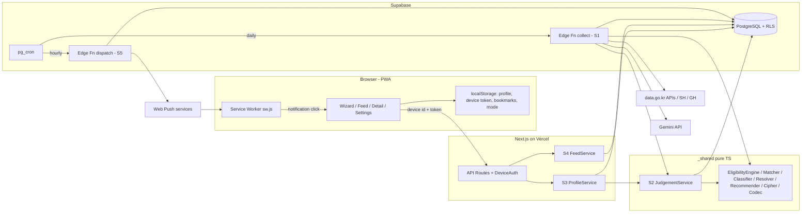

# 모찌네 청약 알리미 — 컴포넌트 의존 관계 · 통신 · 데이터 흐름

---

## 1. 전체 구조도

### Mermaid Diagram



### Text Alternative

```text
Browser(UI, localStorage, sw.js)
  -> Next API (DeviceAuth) -> S3 ProfileService -> S2 JudgementService -> _shared engine
                                                -> DB (devices, device_profiles)
                           -> S4 FeedService    -> DB (judgements + notices)
pg_cron daily  -> collect (S1) -> data.go.kr / SH / GH
                               -> Gemini (notice data only)
                               -> _shared (matcher, classifier, resolver)
                               -> DB (notices) -> S2.recomputeAll -> DB (judgements)
pg_cron hourly -> dispatch (S5) -> DB (devices, judgements, notification_log)
                                -> Web Push -> sw.js -> opens detail or feed
```

---

## 2. 의존 매트릭스

| From \ To | `_shared` 엔진 | DB | Gemini | 외부 소스 | Web Push | localStorage |
|---|:-:|:-:|:-:|:-:|:-:|:-:|
| 클라이언트 UI (C23~C32) | – | – (API 경유) | – | – | 구독만 | ✅ |
| Next API / S3 / S4 | ✅ (S2 경유) | ✅ 서버 키 | – | – | – | – |
| S2 JudgementService | ✅ | ✅ | – | – | – | – |
| collect (S1) | ✅ | ✅ 서버 키 | ✅ | ✅ | – | – |
| dispatch (S5) | – | ✅ 서버 키 | – | – | ✅ | – |
| `_shared` 엔진 (C1~C8) | – | **없음** (순수) | – | – | – | – |

**규칙**
- `_shared`는 DB·네트워크·런타임 API(Deno/Node 전용)를 쓰지 않는다. 예외로 C7은 WebCrypto(양쪽 표준)를 쓴다 → PBT·단위 테스트를 Vitest에서 바로 실행할 수 있음
- 브라우저는 Supabase에 **직접 접근하지 않는다** (anon 키도 쓰지 않음, NFR-2.2)
- Gemini에는 공고 정보만 보낸다. `device_profiles`를 읽는 코드 경로와 Gemini 호출 코드 경로가 섞이지 않게 분리 (FR-4.5)

---

## 3. 통신 패턴

| 구간 | 방식 | 인증 |
|---|---|---|
| 브라우저 → Next API | HTTPS JSON (fetch) | 헤더 `x-device-id` + `x-device-token` (AD-5) |
| Next 서버 → Supabase DB | supabase-js (서버 전용 키) | service role, 서버 환경 변수 |
| pg_cron → Edge Function | HTTP 호출 (`net.http_post`) | Vault에 둔 함수 호출용 시크릿 |
| Edge Function → DB | supabase-js (service role) | 함수 시크릿 |
| collect → 외부 소스 | HTTPS (API 키 쿼리), HTML fetch | data.go.kr 키 |
| collect → Gemini | HTTPS | Gemini 키 |
| dispatch → Push 서비스 | Web Push 프로토콜 (VAPID) | VAPID 개인키 |
| Push → 브라우저 | 서비스워커 `push` 이벤트 | – |

---

## 4. 주요 데이터 흐름

### F1. 프로필 저장 (US-08, 18)
```text
Wizard -> LocalProfileStore.commit (기기 저장 먼저)
       -> PUT /api/profile (실패 시 대기열)
       -> DeviceAuth -> validate -> ProfileCodec.encode(AmountCipher) -> device_profiles
       -> S2.recomputeForDevice -> judgements(이 기기)
       -> 응답 -> 피드 다시 조회
```

### F2. 일일 수집 (FR-1~3, 5, 6)
```text
cron -> collect: 소스별 Collector -> Normalizer -> DistrictMatcher -> SupplyTypeClassifier
     -> (신규/변경) AiSummarizer.extractRequirements -> RequirementResolver
     -> notices upsert -> AiSummarizer.summarize
     -> S2.recomputeAll -> judgements(모든 기기)
```

### F3. 매시 알림 (US-10, 11)
```text
cron -> dispatch: devices(notify_hour = now, enabled) -> judgements(visible) - notification_log
     -> 0건 skip / N건 -> PushSender -> notification_log 기록 (또는 구독 삭제)
     -> 기기 sw.js -> notificationclick -> /notice/[id] 또는 /
```

### F4. 피드 조회 (US-12)
```text
FeedView -> GET /api/feed -> DeviceAuth -> judgements(visible, 이 기기) + notices -> 정렬 -> 카드
```

---

## 5. 열린 이슈와 영향 컴포넌트

| ID | 내용 | 영향 컴포넌트 | 결정 단계 |
|---|---|---|---|
| OI-1 | 세대주 여부 항목 추가 여부 (본인 기준 요건) | C1, C5, C25 | Functional Design (판정 엔진 Unit) |
| OI-2 | 나이 판정 기준일 | C4, C5 | Functional Design |
| OI-3 | 면적 구간 경계·점수 가중치 | C6, C25 | Functional Design |
| OI-4 | 수집 시각과 0시 알림의 관계 | S1, S5 | Infrastructure Design |
| OI-5 | 처음 설정한 기기의 첫 알림: 이미 열려 있던 공고를 "새 공고"로 셀지 | C14, C16 | Functional Design (알림 Unit) |
