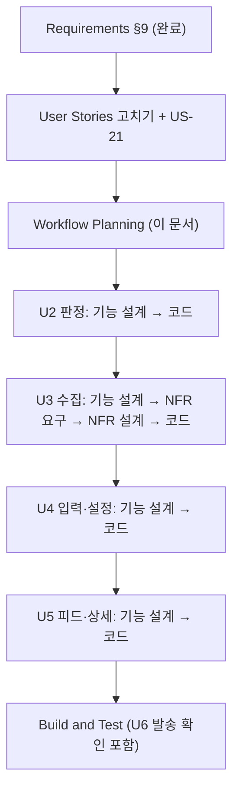

# 변경 요청 2 — 실행 계획

> 기준: requirements.md §9 (2026-10-17 승인). 첫 개발의 실행 계획은 `execution-plan.md`.

## 1. 분석

| 항목 | 내용 |
|---|---|
| 요청 | ① 청약통장 부부 기준 ② 수도권 전체 수집 + 지구·시군구 관심 지역 ③ 설치한 사용자에게 업데이트 안내·새 항목 입력 유도 ④ 거주 기간 문구 |
| 위험도 | **보통** — 판정·수집·입력이 함께 바뀌고 실사용 중인 기기 2대의 저장 데이터를 옮겨야 한다. 되돌리기는 Vercel 이전 배포 + 마이그레이션 되돌림으로 가능 |
| 사용자 영향 | 피드에 보이는 공고가 늘어난다(통장 "없음" → "모름", 시군구 추가). 앱을 열면 안내 카드가 한 번 뜬다 |
| 데이터 영향 | 프로필 스키마 버전 올림(기기·서버), 공고에 지역 칸 추가, 관심 시군구 칸 추가 |
| 외부 영향 | SH 홈페이지 크롤링 추가, Gemini 호출 대상 규칙 변경 |

## 2. 단계 결정

### 🔵 INCEPTION

| 단계 | 결정 | 이유 |
|---|---|---|
| Requirements Analysis | ✅ 완료 | §9 승인 |
| User Stories | **실행 (가볍게)** | 사용자 화면이 바뀐다. 기존 US-04·05·07·12를 고치고 **US-21 업데이트 안내**를 새로 쓴다. 질문 없이 바로 작성 |
| Workflow Planning | ✅ 이 문서 | |
| Application Design | 생략 | 새 서비스·Unit 경계 변화 없음. 새 부품(SH 수집기, 지역 판별, 업데이트 안내)은 각 Unit 기능 설계에서 정의 |
| Units Generation | 생략 | 기존 U1~U6 그대로 |

### 🟢 CONSTRUCTION (Unit 순서대로, 각 Unit 설계+코드를 끝내고 다음으로)

| 순서 | Unit | 기능 설계 | NFR 요구 | NFR 설계 | 인프라 설계 | 코드 | 이유 |
|---|---|:-:|:-:|:-:|:-:|:-:|---|
| 1 | **U2 판정** | ✅ | – | – | – | ✅ | 통장 명의·가구 기준, 노출 조건(지구 또는 시군구). 다른 Unit이 쓰는 공용 규칙이라 먼저 |
| 2 | **U3 수집** | ✅ | ✅ | ✅ | – | ✅ | 지역 판별·수도권 필터, SH 수집기, 요약 대상 제한. 수집 시간 예산·Gemini 한도·크롤링 예절이 새 NFR. DB 마이그레이션(공고 지역 칸)은 코드 단계에서 |
| 3 | **U4 입력·설정** | ✅ | – | – | – | ✅ | 통장 질문, 관심 지역 화면, 거주 기간 문구, 스키마 옮기기, 업데이트 안내·짧은 입력 화면. DB(관심 시군구 칸)는 코드 단계에서 |
| 4 | **U5 피드·상세** | ✅ (작게) | – | – | – | ✅ | 지역 표시, 요약 없는 공고 표시. 노출 규칙은 U2 공용 코드 |
| – | U6 알림 | – | – | – | – | 확인만 | 공용 노출 코드를 쓰므로 자동 반영. Build and Test에서 발송 시험 |
| 5 | **Build and Test** | | | | | ✅ | 전체 단위·PBT·pgTAP·E2E, 운영 반영 안내(마이그레이션·SH 배포 순서) |

인프라 설계를 모두 생략하는 이유: 새 클라우드 자원이 없다(같은 Supabase·Vercel·cron). 마이그레이션과 cron 변경은 각 코드 계획의 단계로 둔다.

## 3. 흐름

텍스트 대안: 요구사항(완료) → 사용자 스토리 고치기 → 실행 계획 → U2 → U3 → U4 → U5 → Build and Test.

## 4. 운영 반영 순서 (미리 정리, Build and Test에서 확정)

1. DB 마이그레이션 0009(공고 지역, 관심 시군구, 프로필 스키마) — 옛 앱도 깨지지 않게 칸 추가만
2. Edge Function `collect`·`analyze`·`dispatch` 배포 (SH·지역·요약 대상)
3. Vercel 배포(push) — 새 입력 화면·안내 카드
4. 부모님 휴대폰: 앱 열기 → 안내 카드 → 통장 명의·관심 지역 입력

## 5. Extension

- PBT: 각 Unit 기능 설계에서 속성 정의(PBT-01), 코드에서 구현. 후보 — 옮기기 멱등, 관심 지역을 늘리면 보이는 공고가 줄지 않음, 명의만 다른 같은 통장은 판정이 같음, 지역 판별 결과는 항상 수도권 목록 안
- Security / Resiliency: 꺼짐
