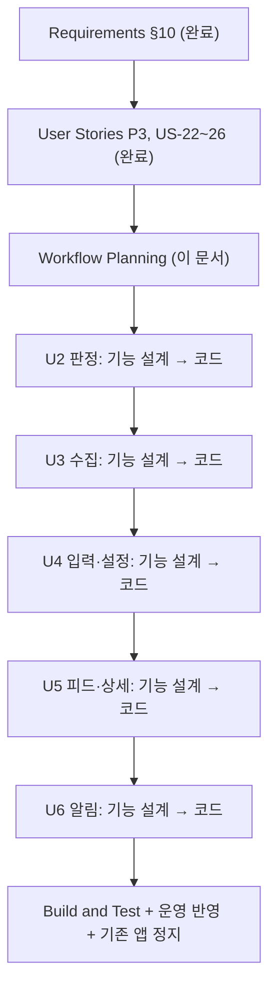

# 변경 요청 3 — 실행 계획 (청약레이더 합치기)

> 기준: requirements.md §10 (2026-10-20 승인), stories US-22~26. 앞선 계획: `execution-plan.md`(첫 개발), `change-2-execution-plan.md`.

## 1. 분석

| 항목 | 내용 |
|---|---|
| 요청 | 기존 청약레이더(예비신혼부부)를 이 앱에 합침: 가구 종류, 신혼 판정, 마감 임박 알림, 요약 "신혼부부가 볼 점". 부모님 앱·데이터 유지 |
| 위험도 | **보통~높음** — 판정 규칙이 크게 늘고(신혼 공급유형 5종), 실사용 중인 부모님 기기 2대의 프로필 버전을 다시 올린다. 노부부 판정이 바뀌면 안 된다(NFR-C3-1) |
| 사용자 영향 | 부모님: 보이는 변화 없음 + 마감 임박 알림 추가. 나: 새로 설치·입력 |
| 데이터 영향 | 프로필 v2 → v3(가구 종류, 신혼 항목), 공급유형 기준 데이터 추가, 관심 공고 ID 서버 표 추가, 요약 형식에 절 추가 |
| 외부 영향 | Gemini 프롬프트·출력 형식 변경(요약 절, 신혼 조건 추출), 기존 청약레이더 정지(운영 작업) |
| 되돌리기 | Vercel 이전 배포 + 함수 이전 커밋 배포. 마이그레이션은 추가만(옛 코드가 깨지지 않게), 프로필은 v2도 계속 읽음 |

## 2. 단계 결정

### 🔵 INCEPTION

| 단계 | 결정 | 이유 |
|---|---|---|
| Requirements Analysis | ✅ 완료 | §10 승인 |
| User Stories | ✅ 완료 (가볍게) | P3, US-22~26 |
| Workflow Planning | ✅ 이 문서 | |
| Application Design | 생략 | 새 서비스·Unit 경계 변화 없음. 새 부품(가구 종류, 신혼 규칙, 마감 임박 대상, 관심 공고 동기화)은 각 Unit 기능 설계에서 |
| Units Generation | 생략 | 기존 U1~U6 그대로 |

### 🟢 CONSTRUCTION (Unit 순서대로, 각 Unit 설계+코드를 끝내고 다음으로)

| 순서 | Unit | 기능 설계 | NFR 요구 | NFR 설계 | 인프라 | 코드 | 이유 |
|---|---|:-:|:-:|:-:|:-:|:-:|---|
| 1 | **U2 판정** | ✅ | – | – | – | ✅ | 가구 종류·프로필 v3·옮기기, 신혼 공급유형·조건·기준 데이터. 다른 Unit이 쓰는 공용 규칙이라 먼저. 가장 큼 |
| 2 | **U3 수집** | ✅ | – | – | – | ✅ | 공급유형 분류·AI 추출(신혼 조건), 요약 "신혼부부가 볼 점"과 기존 요약 채우기. Gemini 한도는 변경 2 NFR(요약 대상 제한) 안에서 — 새 NFR 단계 없이 기능 설계에 하루 채움 수만 정함 |
| 3 | **U4 입력·설정** | ✅ | – | – | – | ✅ | 가구 종류 화면, 신혼 마법사, 설정 그룹·가구 종류 바꾸기 |
| 4 | **U5 피드·상세** | ✅ (작게) | – | – | – | ✅ | 볼 점 절 고르기, 신혼 판정 이유·유형 이름 |
| 5 | **U6 알림** | ✅ | – | – | – | ✅ | 관심 공고 ID 서버 저장(새 표·RLS), 마감 임박 대상·알림 문구, 알림 설정 스위치 |
| 6 | **Build and Test** | | | | | ✅ | 전체 단위·PBT·pgTAP·E2E, **노부부 회귀 확인**(변경 3 전후 같은 판정), 운영 반영, 내 휴대폰 확인 뒤 기존 청약레이더 정지 |

인프라 설계 생략 이유: 새 클라우드 자원 없음(같은 Supabase·Vercel). 마이그레이션은 각 코드 계획의 단계로.

## 3. 흐름

텍스트 대안: 요구사항·스토리(완료) → 실행 계획 → U2 → U3 → U4 → U5 → U6 → Build and Test(운영 반영, 기존 앱 정지).

## 4. 운영 반영 순서 (미리, Build and Test에서 확정)

1. DB 마이그레이션(기준 데이터·관심 공고 표) — 추가만
2. Edge Function `collect`·`analyze`·`dispatch` 배포
3. push(Vercel)
4. 부모님 휴대폰: 아무 변화 없는지 확인(피드·알림)
5. 내 휴대폰: 설치 → 가구 종류 신혼 → 입력 → 알림 켜기
6. 며칠 써 본 뒤 기존 청약레이더 정지

## 5. Extension

- PBT: 각 Unit 기능 설계에서 속성 정의, 코드에서 구현. 후보 — v2→v3 옮기기 멱등, **노부부 판정 불변**(같은 노부부 프로필·공고면 변경 3 전후 같은 결과), 신혼 소득 조건 단조성, 마감 임박 대상 = 관심 공고 ∩ 마감 임박
- Security / Resiliency: 꺼짐

## 6. 변경 2에서 넘어온 것

- 변경 2 Build and Test 승인(05:10 운영 수집 결과 확인 뒤), 0011(GH·SH 서울 리전) 운영 반영 여부
