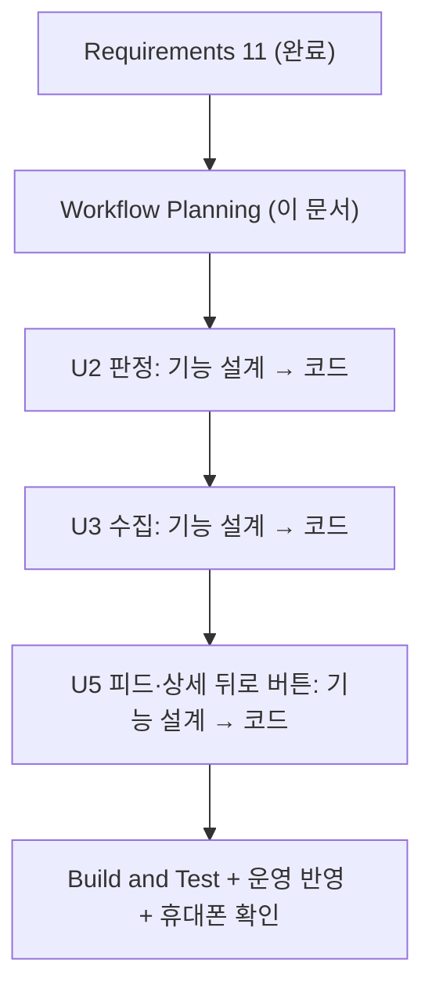

# 변경 요청 4 — 실행 계획 (맞지 않는 공고 거르기·뒤로 버튼)

> 기준: requirements.md §11 (2026-10-25 승인). 앞선 계획: `execution-plan.md`, `change-2-execution-plan.md`, `change-3-execution-plan.md`.

## 1. 분석

| 항목 | 내용 |
|---|---|
| 요청 | 지역(시·군 못 찾음)·대상(기숙사·창업·소득 계층)이 맞지 않는 공고가 피드에 보임, AI 분석 거의 전부 실패, 상세에서 뒤로 버튼이 앱을 닫음 |
| 위험도 | **보통** — 노출 규칙을 좁히므로 **놓치는 공고**가 생길 수 있다(NFR-C4-1). 부모님 피드도 같이 바뀐다(Q4=A) |
| 사용자 영향 | 두 가구 모두 피드·알림의 엉뚱한 공고가 빠짐. 지역을 못 찾는 공고는 "시도 전체"를 고른 가구에만 보임 |
| 데이터 영향 | 공고 지역 다시 계산(기존 공고 포함), 공고 대상 칸·분석 실패 이유 칸 추가, 실패 공고 다시 분석, 전 기기 다시 판정 |
| 외부 영향 | 원문 상세 읽기(지금 요청 수 안에서), Gemini 추출 항목 추가(신청 대상) |
| 되돌리기 | Vercel 이전 배포 + 함수 이전 커밋. 마이그레이션은 추가만 |

## 2. 단계 결정

### 🔵 INCEPTION

| 단계 | 결정 | 이유 |
|---|---|---|
| Requirements Analysis | ✅ 완료 | §11 승인 |
| User Stories | 생략 | 기존 스토리(US-05 지역, US-07 피드, US-10 알림, 뒤로 버튼 2026-10-17)의 결함 수정·규칙 좁히기. 새 사용자·흐름 없음 |
| Workflow Planning | ✅ 이 문서 | |
| Application Design | 생략 | 새 서비스·Unit 경계 변화 없음 |
| Units Generation | 생략 | 기존 U1~U6 그대로 |

### 🟢 CONSTRUCTION (Unit 순서대로, 각 Unit 설계+코드를 끝내고 다음으로)

| 순서 | Unit | 기능 설계 | NFR 요구 | NFR 설계 | 인프라 | 코드 | 이유 |
|---|---|:-:|:-:|:-:|:-:|:-:|---|
| 1 | **U2 판정** | ✅ | – | – | – | ✅ | 관심 지역 규칙(시도까지만 → 안 맞음, BR-U2-C11 바꿈), 대상 분류 값·가구 종류 × 대상 숨김 표, "행복주택" 분류 고침, 노출 조건. 공용 규칙이라 먼저 |
| 2 | **U3 수집** | ✅ | – | – | – | ✅ | 시 이름 정리(특례시), 제목·지구 이름·상세 본문·첨부 이름에서 시·군 찾기, 대상 분류(제목·상세), AI 추출 항목(대상), **AI 분석 실패 원인 조사·수정**, 실패 이유 기록, 기존 공고 지역 다시 계산·다시 분석. 요청 수·Gemini 한도는 변경 2·3 NFR 안에서 — 기능 설계에 수만 정함 |
| 3 | **U5 피드·상세** | ✅ (작게) | – | – | – | ✅ | 뒤로 버튼(상세 → 목록, 3초·새 문구), 실제 Android 휴대폰 재현·확인. 피드 노출은 U2 공용 코드라 따로 바꿀 것 없음 |
| 4 | **Build and Test** | | | | | ✅ | 단위·PBT·pgTAP·E2E, **문제 9건 + 지금 맞게 보이는 공고 회귀 확인**(두 가구), 운영 반영, 휴대폰 확인 |

- U4 입력·설정: 바뀌는 것 없음(새 질문 없음, §11.4) — 생략
- U6 알림: 노출 조건을 U2 공용 코드로 쓰므로 코드 변경 없음 — Build and Test에서 알림 대상이 피드와 같은지만 확인
- U1: 마이그레이션(대상·실패 이유 칸, 다시 판정)은 U2·U3 코드 계획의 단계로
- 인프라 설계 생략: 새 클라우드 자원 없음

## 3. 흐름

텍스트 대안: 요구사항(완료) → 실행 계획 → U2 판정 → U3 수집 → U5 뒤로 버튼 → Build and Test(운영 반영, 휴대폰 확인).

## 4. 운영 반영 순서 (미리, Build and Test에서 확정)

1. DB 마이그레이션(대상·실패 이유 칸) — 추가만
2. Edge Function `collect`·`analyze`·`dispatch` 배포
3. 기존 공고 지역·대상 다시 계산 → 전 기기 다시 판정
4. 실패 공고 다시 분석(하루 한도 안에서 며칠에 나눠)
5. push(Vercel)
6. 내 휴대폰: 문제 9건이 빠졌는지, 부천·광명·과천 등 공고는 그대로인지, 뒤로 버튼
7. 부모님 휴대폰: 피드에서 맞는 공고가 빠지지 않았는지

## 5. Extension

- PBT: 각 Unit 기능 설계에서 속성 정의, 코드에서 구현. 후보 — 시·군 찾기는 정보가 늘면 지역이 줄지 않음, 노출 단조성(관심 지역을 늘리면 보이는 공고가 줄지 않음), 대상 숨김 = 가구 종류 × 대상 표, 시 이름 정리 멱등
- Security / Resiliency: 꺼짐

## 6. 범위 밖 (함께 발견)

- 알림 발송 멈춤: 매시 정각 "Vault 값 없음: dispatch_url 또는 cron_secret". U6 운영 설정(setup-guide-u6 ⑤⑥) — 따로 처리
- 변경 3에서 남은 일: 기존 청약레이더 정지
