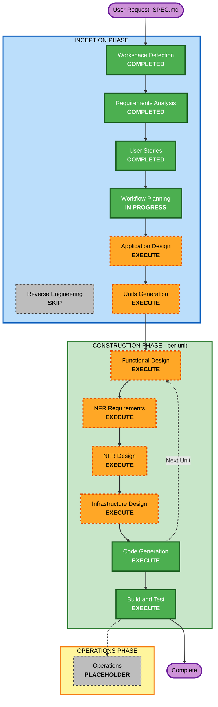

# Execution Plan — 모찌네 청약 알리미

> 근거: requirements.md (D1~D20, FR-1~11, NFR-1~7), stories.md (US-01~20, OI-1~3), personas.md
> Extension: Security No · Resiliency No · **PBT Yes (Full)**

---

## Detailed Analysis Summary

### Change Impact Assessment
- **User-facing changes**: Yes. 화면 신규(피드·상세·관심 공고·설정·입력 마법사·설치/알림 안내), 고령자 UX와 일반/쉬운 모드
- **Structural changes**: Yes. 새 시스템 아키텍처: Next.js PWA + Supabase(DB·Edge Functions·pg_cron·Vault) + 수집 파이프라인 + 푸시 발송기
- **Data model changes**: Yes. 공고·주택형·지구 설정·소득자산 기준표·기기 프로필(암호화 컬럼)·푸시 구독·알림 발송 이력 스키마, RLS
- **API changes**: Yes. 외부 소스 5개 어댑터(API 3 + 크롤링 2), Gemini 요약, Edge Function(프로필 동기화·구독 등록·삭제·수집·발송)
- **NFR impact**: Yes. 금액 컬럼 암호화·RLS(NFR-2), 재실행 안전(NFR-3.2), 고령자 접근성(NFR-1), PBT(NFR-6.4)

### Risk Assessment
- **Risk Level**: Medium
  - 판정 오류 → "미충족 숨김"(D9) 때문에 공고를 놓칠 수 있음 (R1)
  - 보안 Extension 없이 정확한 소득·자산을 서버에 저장 (R2)
  - 외부 API/HTML 구조 변동 (R4), iOS 푸시 제약 (R3)
- **Rollback Complexity**: Easy (Greenfield, 가족 전용 비공개 운영)
- **Testing Complexity**: Complex (판정 규칙 경계 사례 + PBT + 목업 기반 통합 + E2E)

---

## Workflow Visualization

### Mermaid Diagram



### Text Alternative

```text
Phase 1: INCEPTION
- Workspace Detection      : COMPLETED
- Reverse Engineering      : SKIP (Greenfield)
- Requirements Analysis    : COMPLETED
- User Stories             : COMPLETED
- Workflow Planning        : IN PROGRESS
- Application Design       : EXECUTE
- Units Generation         : EXECUTE

Phase 2: CONSTRUCTION (unit by unit)
- Functional Design        : EXECUTE (units with business logic)
- NFR Requirements         : EXECUTE (units with NFR impact)
- NFR Design               : EXECUTE (units with NFR Requirements output)
- Infrastructure Design    : EXECUTE (units touching Supabase/Vercel)
- Code Generation          : EXECUTE (every unit)
- Build and Test           : EXECUTE (after all units)

Phase 3: OPERATIONS
- Operations               : PLACEHOLDER
```

---

## Phases to Execute

### 🔵 INCEPTION PHASE
- [x] Workspace Detection (COMPLETED)
- [x] Reverse Engineering (SKIPPED: Greenfield)
- [x] Requirements Analysis (COMPLETED)
- [x] User Stories (COMPLETED)
- [x] Execution Plan (IN PROGRESS)
- [ ] Application Design - **EXECUTE**
  - **Rationale**: 새 컴포넌트가 많고(수집기·지구 매처·판정 엔진·요약기·프로필 동기화·푸시 발송기·UI), **판정 엔진을 클라이언트와 서버가 같이 쓰는 구조**(FR-5.6)와 컴포넌트 경계를 정해야 함
- [ ] Units Generation - **EXECUTE**
  - **Rationale**: 수집 / 데이터 / 판정 / UI / 푸시가 독립적으로 만들고 테스트할 수 있는 단위로 나뉨. cheongYak-radar에서 어떤 모듈을 가져올지(D3)도 Unit별로 정해야 함

### 🟢 CONSTRUCTION PHASE (Unit별로 해당할 때만)
- [ ] Functional Design - **EXECUTE**
  - **Rationale**: 공급유형별 자격 판정 규칙, 나이 기준일(OI-2), 세대주 항목(OI-1), 추천 점수(OI-3), 지구 매칭 규칙, 알림 대상 선정 규칙을 설계해야 함. **PBT-01**(테스트 가능한 속성 식별)이 이 단계 필수 산출물
  - 적용 대상(예상): 수집·매칭, 판정 엔진, 알림 발송, 프로필·피드 UI
- [ ] NFR Requirements - **EXECUTE**
  - **Rationale**: **PBT-09**(fast-check 선정·설정) 필수, E2E 도구(Playwright) 확정, 금액 암호화 방식(NFR-2.3), 피드 성능 목표(NFR-4.1), Edge Function 실행 시간 제한(NFR-4.2)
  - 적용 대상(예상): 데이터 플랫폼, 판정 엔진, 수집, 푸시
- [ ] NFR Design - **EXECUTE**
  - **Rationale**: 암호화·RLS·Edge Function 경유 접근 패턴(NFR-2.2/2.3), 알림 중복 방지(멱등) 패턴(NFR-3.2), 소스별 실패 격리(NFR-3.1)를 설계에 반영
  - 적용 대상(예상): NFR Requirements를 실행한 Unit만
- [ ] Infrastructure Design - **EXECUTE**
  - **Rationale**: 새 Supabase 프로젝트(D4), pg_cron 2종(매일 수집, **매시 정각 발송**), Edge Functions, Vault 시크릿, VAPID 키, Vercel 환경 변수 매핑
  - 적용 대상(예상): 데이터 플랫폼, 수집, 푸시
- [ ] Code Generation - **EXECUTE (ALWAYS)**
  - **Rationale**: Unit별 구현과 테스트(예시 기반 + PBT) 생성
- [ ] Build and Test - **EXECUTE (ALWAYS)**
  - **Rationale**: 단위·통합·E2E·PBT 실행 방법(seed 기록 포함, PBT-08)

### 🟡 OPERATIONS PHASE
- [ ] Operations - PLACEHOLDER

---

## 예상 Unit 구성 (참고용, Units Generation에서 확정)

| 예상 Unit | 내용 | 주요 스토리 |
|---|---|---|
| U1 프로젝트 셋업 + 데이터 플랫폼 | Next.js/Supabase/PWA 뼈대, 스키마·RLS·암호화, 지구·기준표 시드 | (기반) |
| U2 수집 파이프라인 | 소스 5개 어댑터, 정규화, 지구 매칭, 공급유형 분류, Gemini 요약 | US-12·13·15의 데이터 |
| U3 자격 판정 엔진 | 공유 순수 함수 판정 + 추천 점수 (PBT 핵심) | US-10·12·14 |
| U4 프로필 입력 + 설정 | 마법사, 동기화, 수정, 모드, 삭제 | US-02·04~09·18~20 |
| U5 피드 · 상세 · 관심 공고 | 화면, 판정 배지, 캘린더 | US-12~17 |
| U6 PWA 설치 + 푸시 알림 | 설치 안내, 구독, 매시 발송, 알림 클릭 이동 | US-01·03·09~11 |

---

## Estimated Timeline
- **Total Stages**: 남은 INCEPTION 2개 + CONSTRUCTION (Unit 약 6개 × 최대 5단계) + Build and Test
- **Estimated Duration**: 세션 기준 여러 회차. Unit마다 설계와 코드 각각 승인 필요

## Success Criteria
- **Primary Goal**: 관심 지구에서 **자격이 되는 공고를 놓치지 않고** 하루 1번 알림으로 받는다 (Q6=A)
- **Key Deliverables**: 배포된 PWA(Vercel), Supabase 프로젝트(스키마·Edge Functions·cron), 테스트 스위트(Vitest + fast-check + Playwright), aidlc-docs 설계 문서
- **Quality Gates**
  - 모든 스토리 인수 기준 충족 (US-01~20)
  - 판정 엔진: 예시 기반 테스트 + PBT (PBT-01~10 준수, blocking)
  - 알림 수 = 피드 수 일치(US-10), 재실행 시 중복 알림 없음(NFR-3.2)
  - 공통 접근성 기준(글씨·터치 영역·대비) 충족
